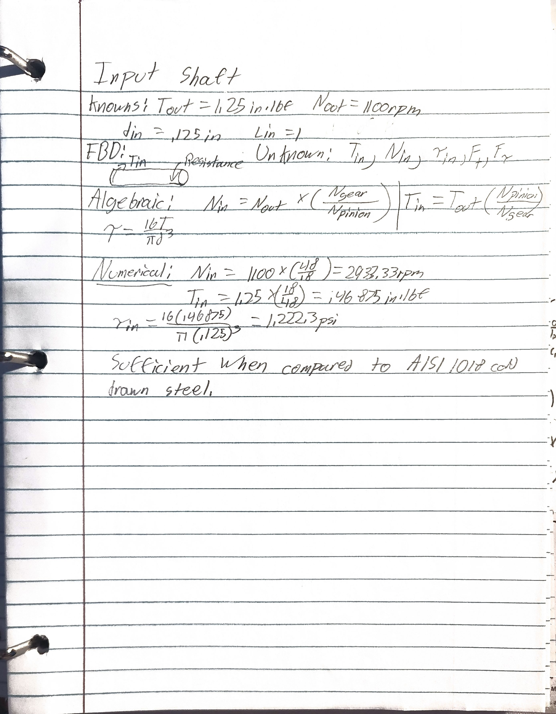
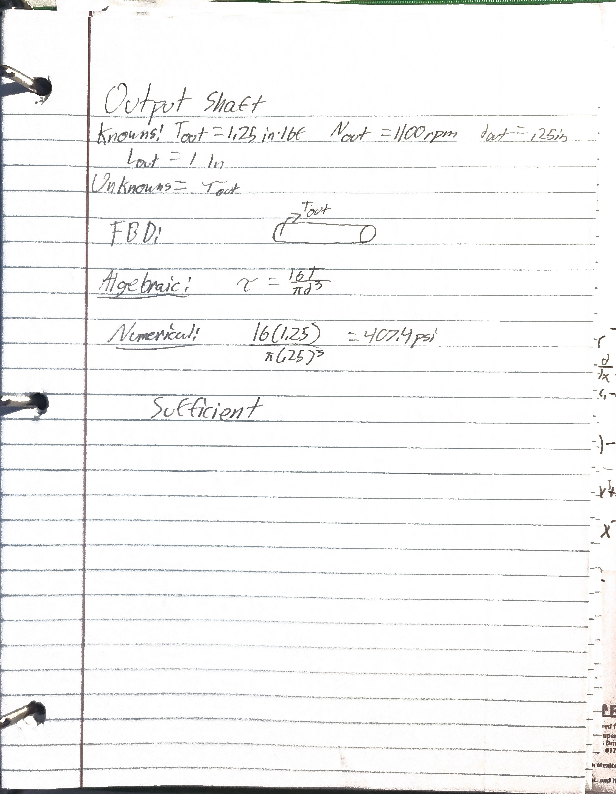
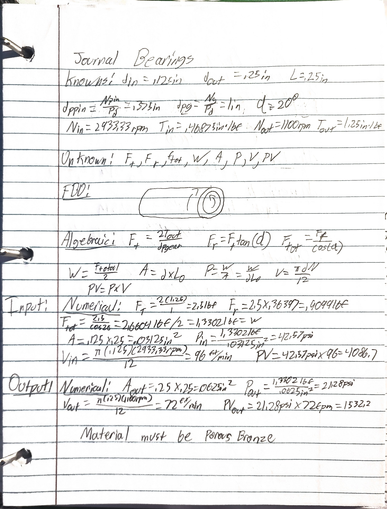
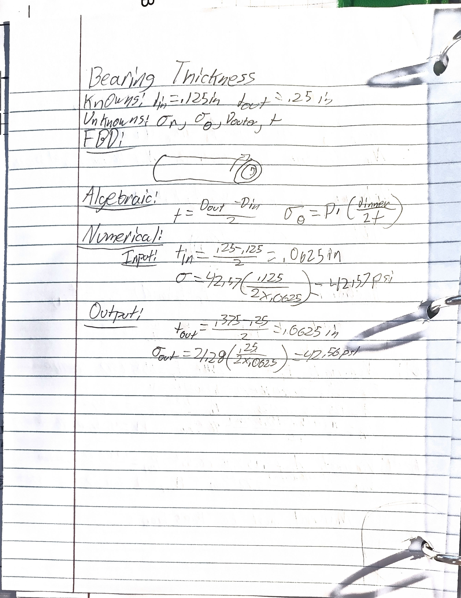
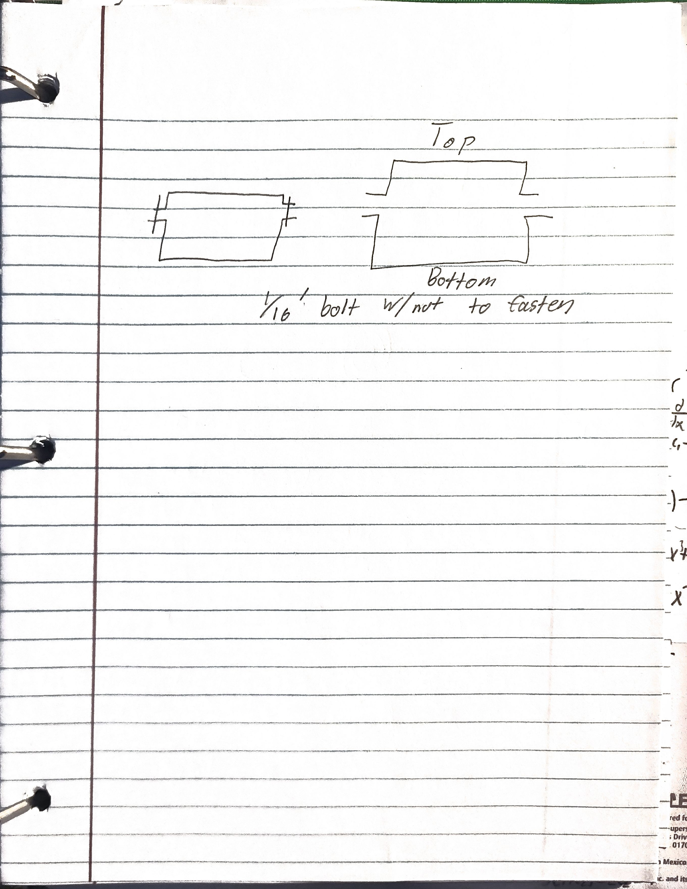

# A8 – Gears

## Objective
The objective of this assignment is to design and test each component of a gearbox, including shafts, bearings, gears, and the casing.

## Analyze
### Input Shaft

### Output Shaft

### Journal Bearings

#### Journal Thickness

### Case Sketch

## Decide
Through algebraic analysis, I have decided that the shaft thickness for both input and output are sufficient. I have also decided to use porous bronze as the journal bearing material and 1/16th inch bolts as the case connection. 

## Communicate
Partway through the project, I realized that McMaster-Carr has no journal bearings with the outside diameter of 1/8th of an inch, so the shaft would have to go directly into the gear with oil or I would have to design my own journal bearing.

## CAD Links
### Journal Bearings
https://a360.co/4iJQaAO
https://a360.co/4e2kqnX

### Gears
https://a360.co/4BBN21y
https://a360.co/4k4lcVt
https://a360.co/4imIC5P
https://a360.co/4kk9PIS

### Assembly
https://a360.co/48kDcDH
https://a360.co/4eWiXQk

### Bottom Case
https://a360.co/4jLVBjL
https://a360.co/4A3Sj0l

### In Shaft
https://a360.co/4zqxGew
https://a360.co/4zh55bN

### Out Shaft
https://a360.co/4iJSMPg
https://a360.co/4iJS98e

### Top Case
https://a360.co/4iLs4FS
https://a360.co/4Bo6oqG
