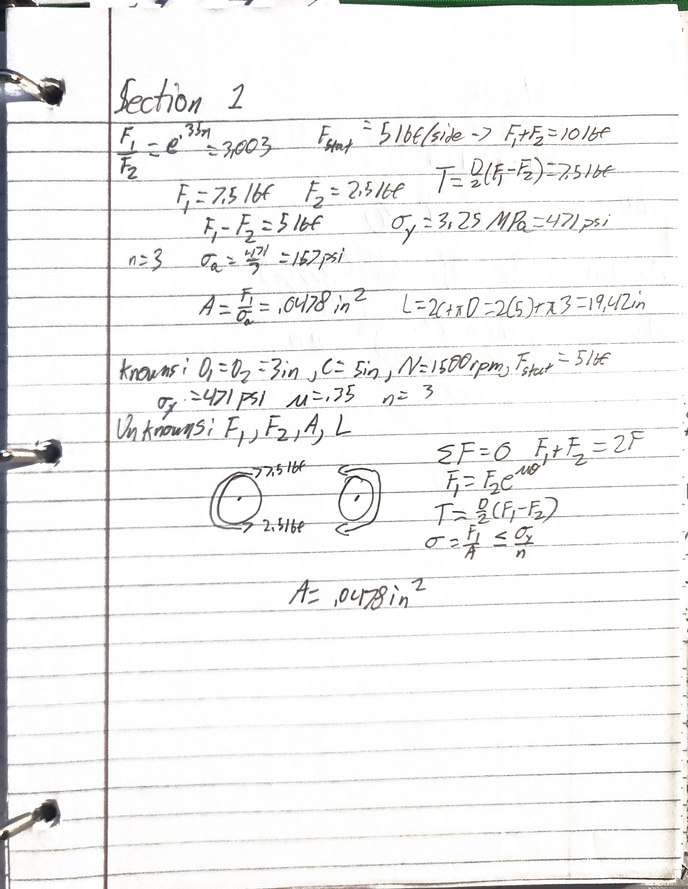
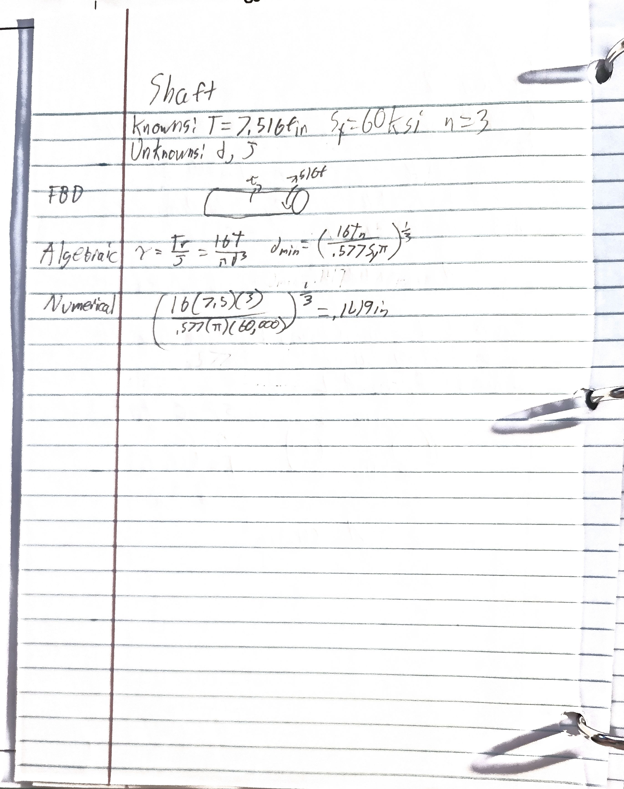
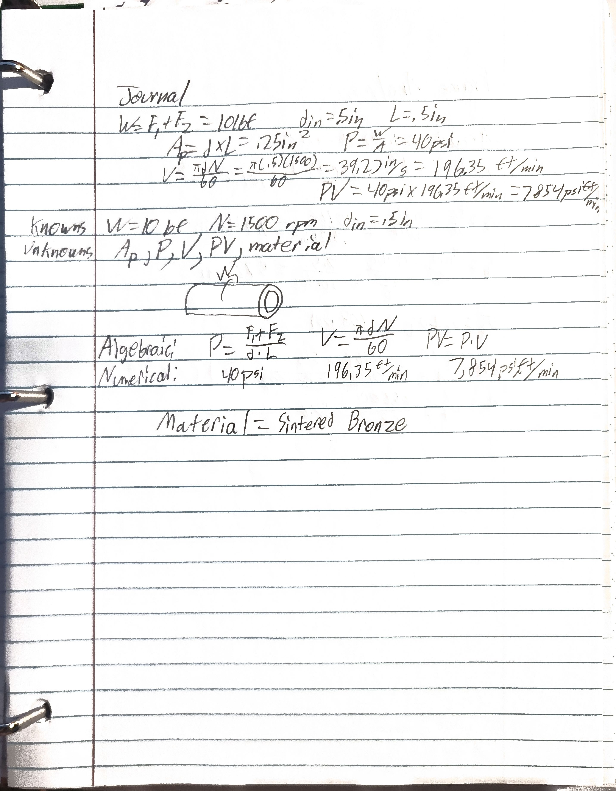
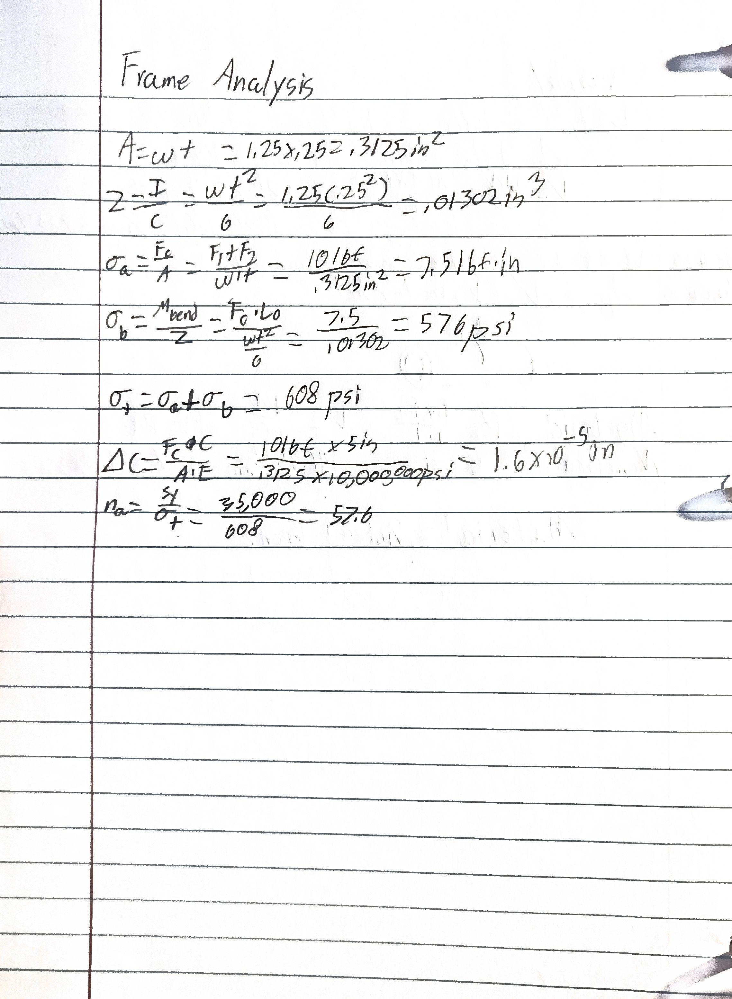
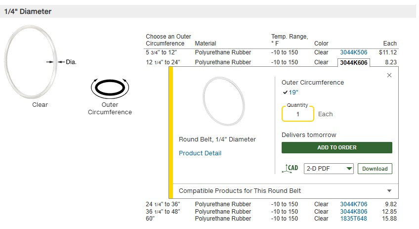

# A9 – Pulleys

## Objective
The objective of this project covers engineering analysis, modeling, and selection of a pulley power transmission system and brace. 

## Analyze
### Pulley

### Shaft

### Journal Bearing

### Frame Analysis

## Decide
This is the belt I decided to use from resource one.

Sintered bronze was chosen over rolling-element ball bearings because the operating load is light and speed is moderate. The resulting PV rating is well within material ratings.
Aluminum will be used for the frame as it has high strength to weight ratio.

## Communicate
This project took about four hours total. I also initially missed the conversion between MPa and PSI.
