A10 – Lead Screw Translating System
## Objective

Design a lead-screw-driven translating system for a tensile tester that applies up to 2 kN: size the leadscrews, select the nut and flange, design the crosshead, verify it with hand calculations and finite element analysis, and document the parametric assembly, component costs, and a fully dimensioned engineering drawing.

## Analyze
### Leadscrew Design (Liam DiProfio)

To begin designing the tensile tester, I performed the necessary calculations to determine the minimum leadscrew diameter and required rotational speed. The calculations account for the 2 kN maximum tensile load and the required factor of safety.

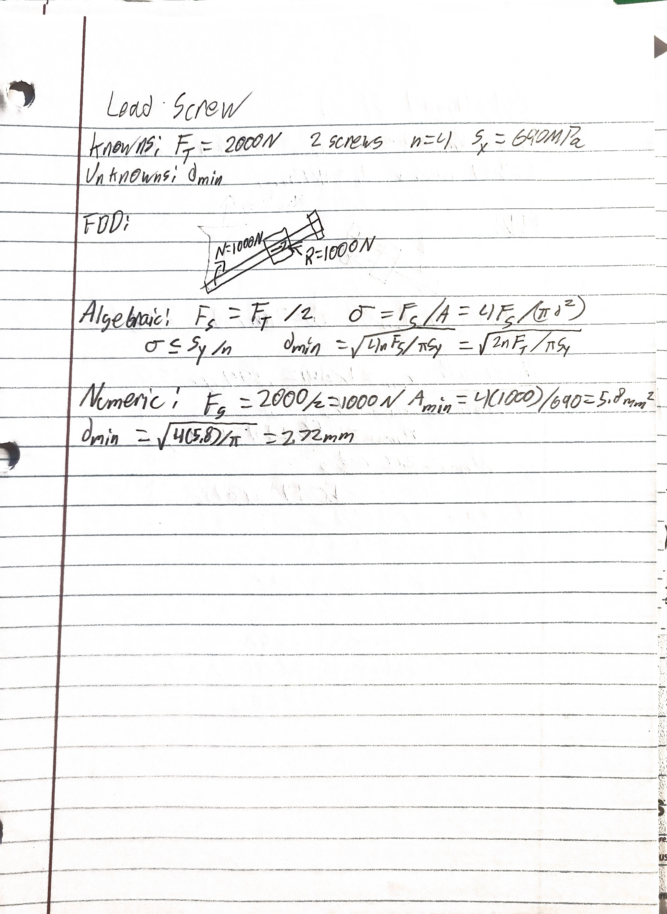

Next, I calculated the required rotational speed range to achieve the specified crosshead linear speed.

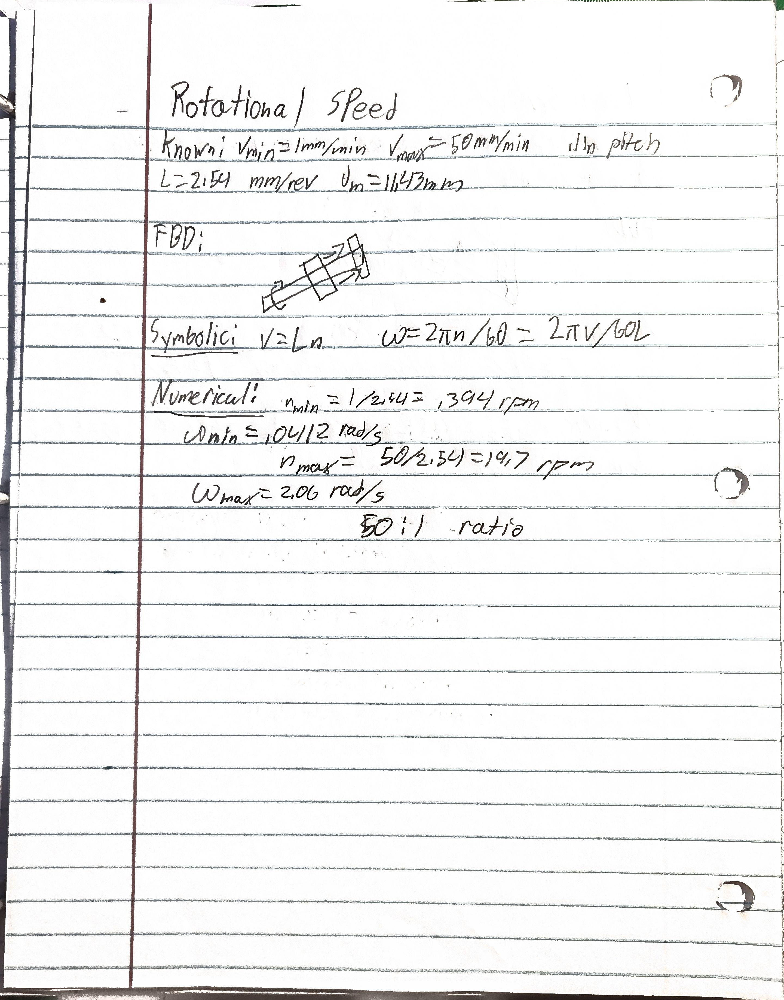

After completing the calculations, I selected the leadscrew specifications based on the required loading and operating conditions. Both leadscrews will use identical components.

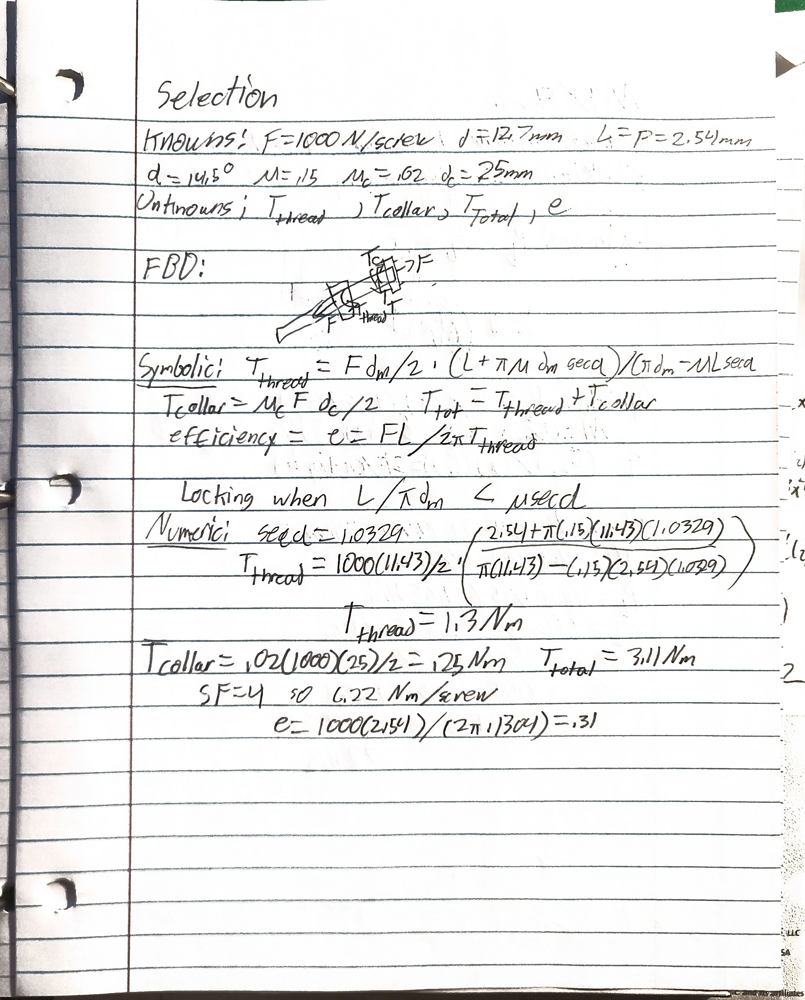

### Nut and Flange Selection (Liam DiProfio)

After selecting the leadscrews, I analyzed the internal threads of the nut to verify that they could safely support the applied load. The following calculations were used to evaluate the thread strength and determine a suitable nut and flange.

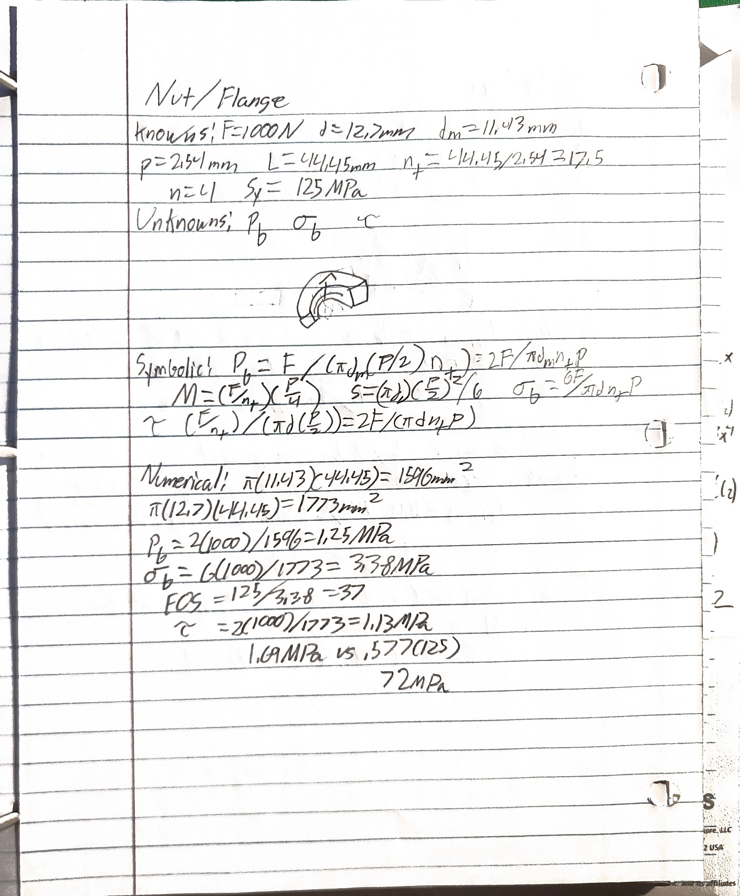

McMaster-Carr listing for the selected Precision Acme flange nut, 97790A110

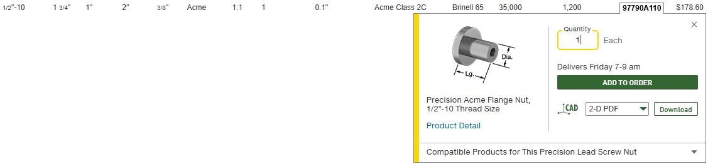

McMaster-Carr listing for the selected Precision Acme lead screw, 98940A625

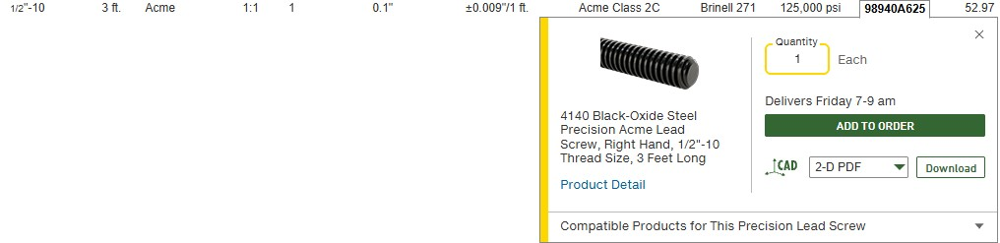

### Crosshead Design (Jordi Melendez Salgado)

After selecting the leadscrews and flange assembly, I moved on to designing the crosshead. I performed a beam stress analysis to determine the required dimensions and material needed to safely withstand the applied 2 kN tensile load while maintaining the required factor of safety.

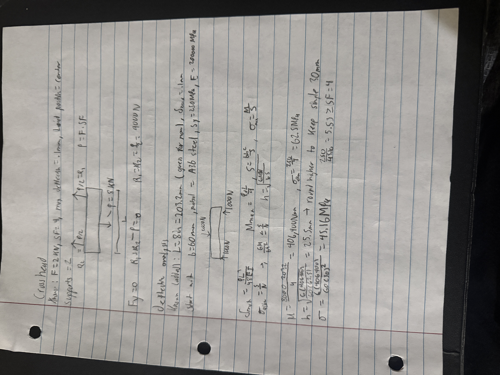

I then performed a deflection analysis to verify that the crosshead would remain within the maximum allowable deflection of 0.1 mm. The following image also includes the preliminary crosshead sketch and its dimensions.

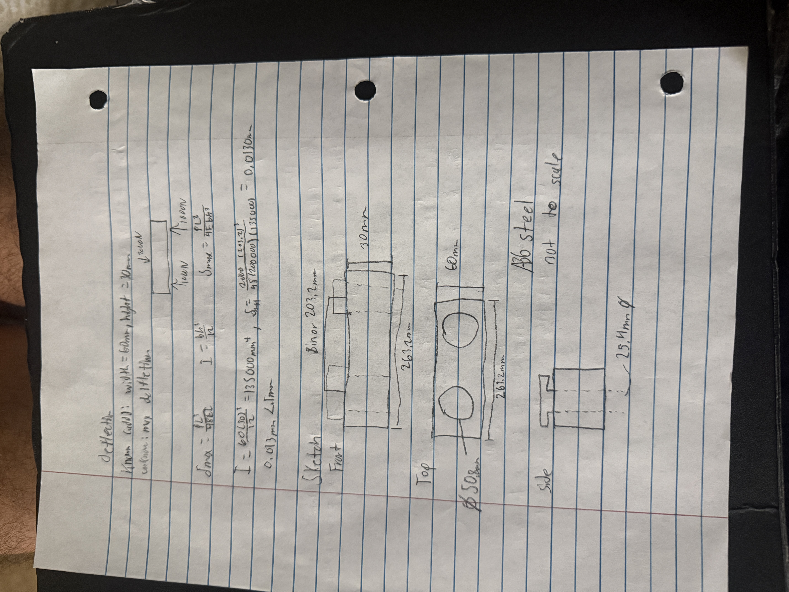

### Crosshead Finite Element Analysis (Jordi Melendez Salgado)

I performed an initial SolidWorks simulation to evaluate the crosshead under the applied loading conditions. The following results show the von Mises stress, displacement, and strain throughout the crosshead.

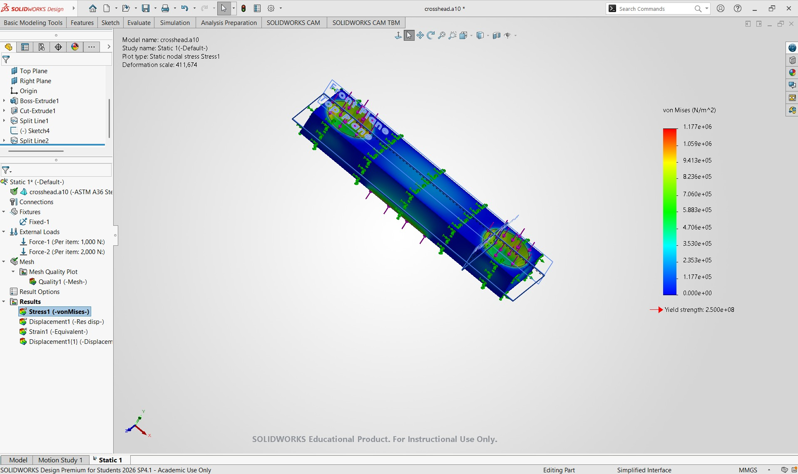

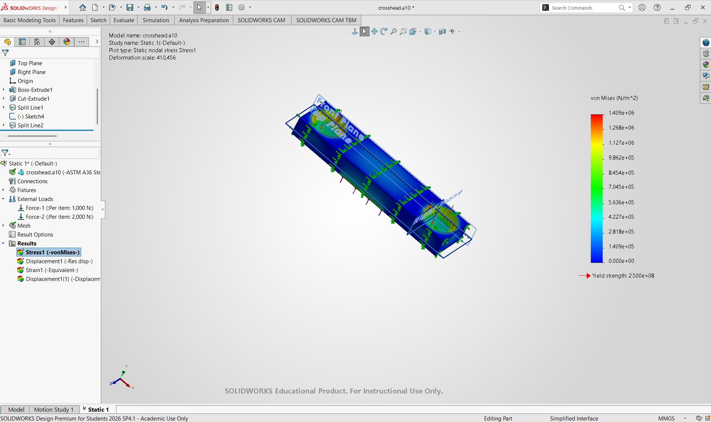

The crosshead was assigned A36 structural steel, which has a yield strength of approximately 250 MPa. Using the maximum von Mises stress of 1.177 MPa, the calculated factor of safety is approximately 212.4. This indicates that the crosshead remains well below the material's yield strength under the simulated loading conditions.

Second Mesh Test (Jordi Melendez Salgado)

I performed a second simulation using a refined mesh to evaluate how the mesh affected the crosshead results.

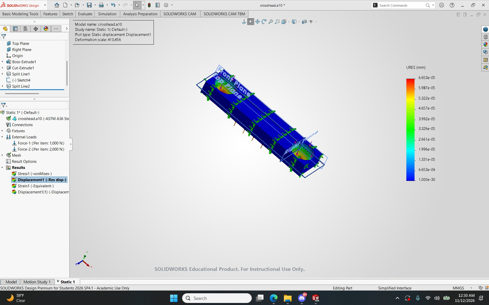

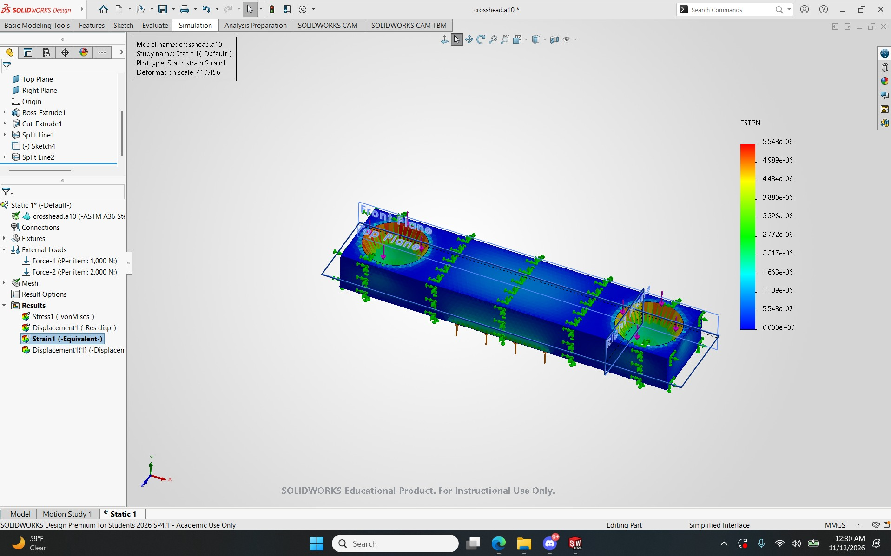

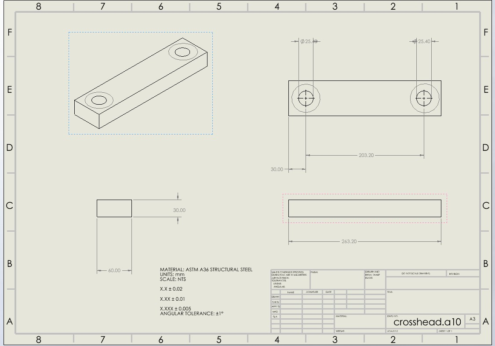

Using the A36 steel yield strength of 250 MPa, the calculated factor of safety for this test is approximately 177.4.

## Decide
Tabulating Costs (Jordi Melendez Salgado)

The following table summarizes the purchased components required for the tensile tester, including their quantities and costs.

<table>
    <thead>
        <tr>
            <th>Item Number</th>
            <th>Quantity</th>
            <th>Name</th>
            <th>Cost/Item</th>
            <th>Cost</th>
            <th>Purchase Link</th>
        </tr>
    </thead>
    <tbody>
        <tr>
            <td>97790A110</td>
            <td>2</td>
            <td>Precision Acme Flange Nut</td>
            <td>$178.60</td>
            <td>$357.20</td>
            <td><a href="https://www.mcmaster.com/97790A110/" target="_blank">McMaster-Carr</a></td>
        </tr>
        <tr>
            <td>98940A625</td>
            <td>2</td>
            <td>4140 Steel Precision Acme Leadscrew</td>
            <td>$52.97</td>
            <td>$105.94</td>
            <td><a href="https://www.mcmaster.com/98940A625/" target="_blank">McMaster-Carr</a></td>
        </tr>
        <tr>
            <td>40-4040</td>
            <td>2</td>
            <td>Metric T-Slot Framing (3 m)</td>
            <td>$107.33</td>
            <td>$214.66</td>
            <td><a href="https://www.grainger.com/category/material-handling/structural-framing-systems/t-slot-framing-systems/profiles-for-t-slot-framing/metric-profiles-for-t-slot-framing" target="_blank">Grainger</a></td>
        </tr>
        <tr>
            <td colspan="4">Total Cost</td>
            <td>$677.80</td>
            <td></td>
        </tr>
    </tbody>
</table>

## Communicate
Parametric Modeling (Jordi Melendez Salgado)

Below is the completed SolidWorks assembly of the tensile tester. The assembly combines the designed crosshead with the selected leadscrews, flange nuts, and structural framing.

Completed SolidWorks assembly of the tensile tester

Figure 9: Completed parametric SolidWorks assembly of the tensile tester.

CAD Files
   <a href="files/a.10.zip" download>
    Download Complete SolidWorks Assembly

Lessons Learned (Liam DiProfio)

Throughout this project, I learned how to apply mechanical design principles to develop a lead-screw-driven tensile tester. One of the most important lessons was understanding how rotational torque is converted into linear force through a lead screw. I also gained experience selecting components based on strength, safety factors, and dimensional requirements while considering crosshead deflection.

This project took approximately 15 hours of design work, including calculations, component selection, and SolidWorks modeling.
