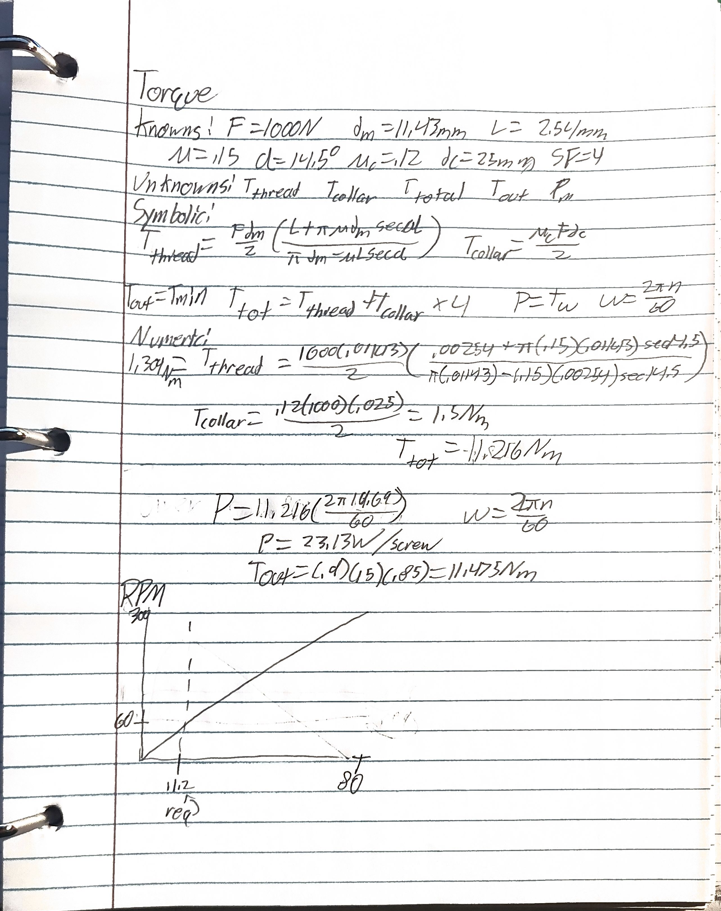
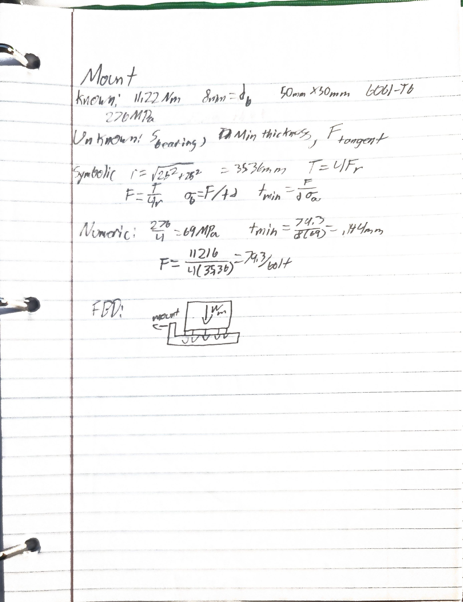
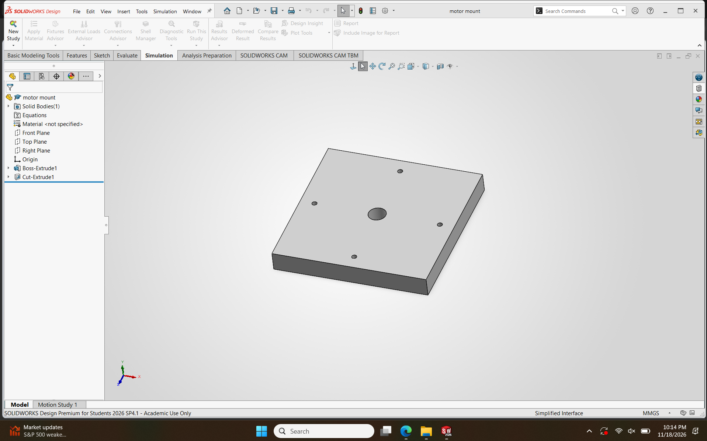
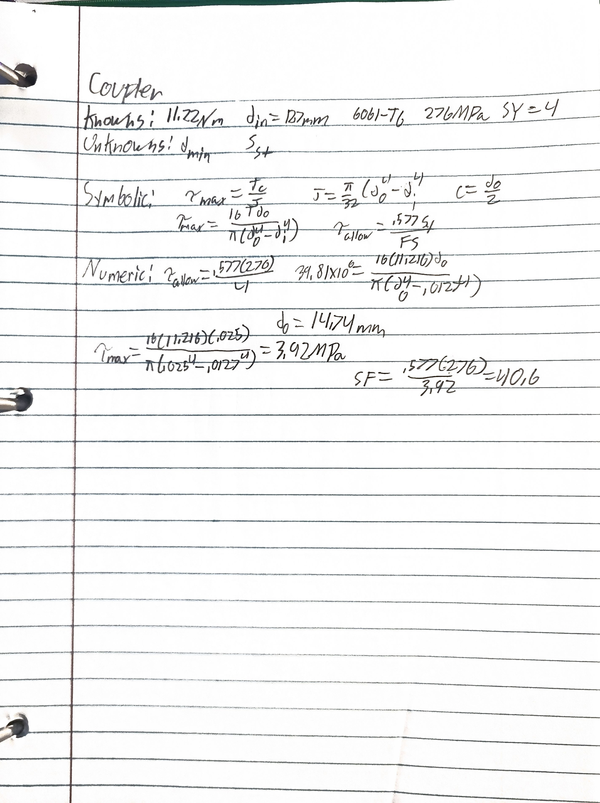
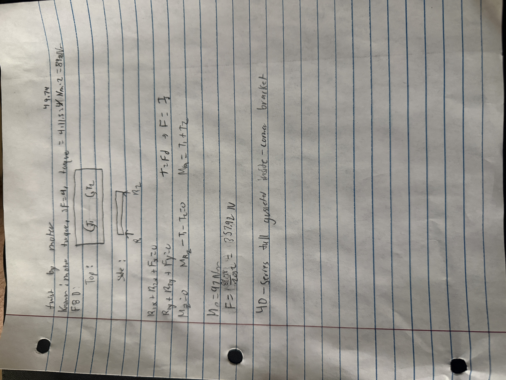
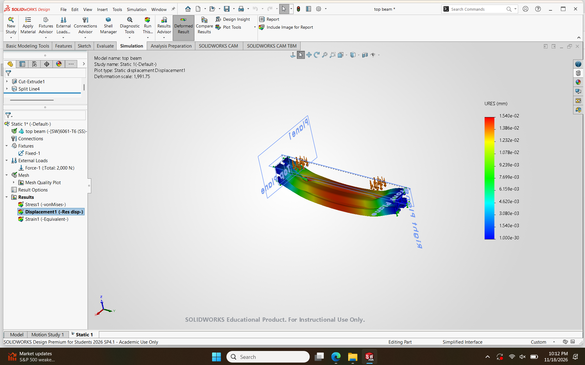
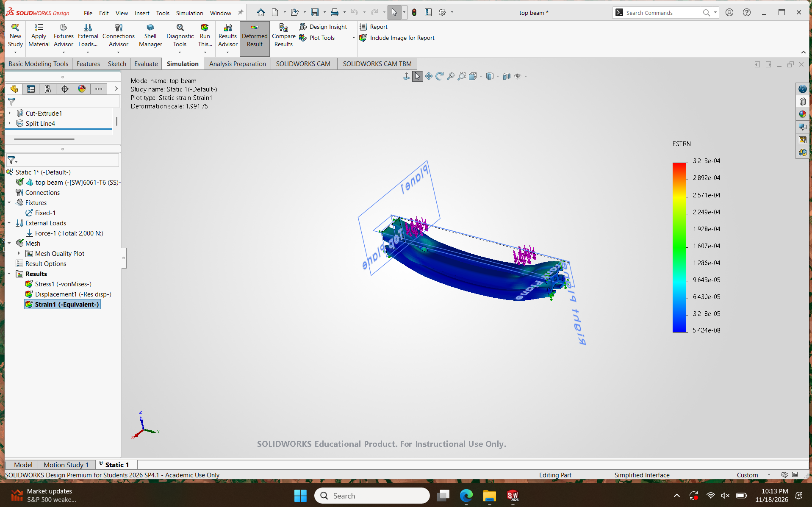
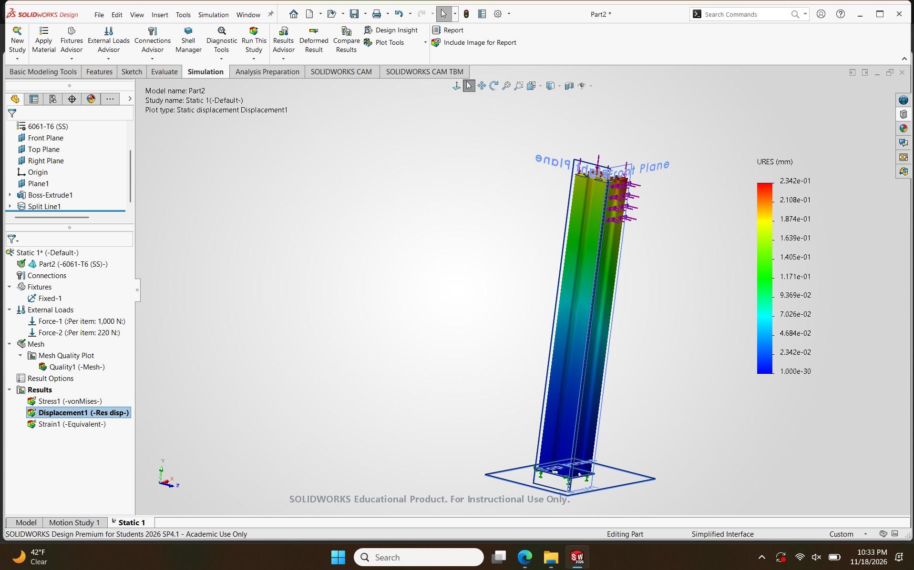

# A11: Motor Selection Design

## Part 1
### Motor Selection

#### Motor Spec Sheet
https://www.midwestmotion.com/products/brgp/12v/26-29rpm/275-400inlb/MMP%20D33-655A-12V%20GP81-100.pdf

### Motor Mount Design

### Coupler Selection/ Design

#### Jaw Coupling Info Sheet (AL090)
https://www.lovejoy-inc.com/products/jaw-type-couplings/al-type-aluminum-jaw-coupling/

## Part 2

### T-Slot Connectors

### Top of Frame FEA

![Work for Step 2 Part 1]

### Floating Bearing
Design Specifications
Fit Class: RC3 precision running fit for smooth rotation and minimal
radial clearance.
Material: 6061-T6 aluminum.
Mount Size: 50.0 mm × 50.0 mm × 15.0 mm.
Mounting: Two M6 socket head cap screws with T-nuts.
Dimensions
Bearing Bore Diameter: 12.70 mm.
Base Footprint: 50.0 mm × 50.0 mm.
Mounting Hole Diameter: 6.4 mm (close fit) or 6.6 mm (normal fit) for M6 screws.
Hole Center Spacing: 203.20 mm.
Mount Thickness: 15.0 mm.
Tolerances
Base Footprint: ±0.01 mm.
Hole Center Spacing: ±0.01 mm.
Mount Thickness: ±0.01 mm.
Mounting Hole Diameter:
Close Fit: 6.40 mm to 6.55 mm.
Normal Fit: 6.60 mm to 6.82 mm.

### Bill of Materials
[Download File](Tensile_Tester_BOM_and_Labor.xlsx)

Lessons Learned

During this project, I learned how to choose a motor that is strong enough to move the machine. I also learned how to connect the motor to the leadscrew using a coupler and make sure the parts can handle the forces applied to them. Another thing I learned was that all parts of the frame need to be strong enough to support the motor and moving components. The floating bearing helped me understand how bearings keep a shaft aligned while still allowing it to rotate smoothly. Overall, this project helped me learn how different parts work together to make a machine function properly. Time spent was 15 hours.

